# Keito 🧶

Aplicación Android para la comunidad de tejido a crochet. Reúne una biblioteca de patrones, un contador de vueltas controlado por voz, videos tutoriales de puntos básicos y un mapa con tiendas de lanas cercanas.

Proyecto personal desarrollado para el curso **Programación Android (IEI-093)**, Ingeniería en Informática, IP-CFT Santo Tomás, sede Iquique.

## Ficha del proyecto

| Campo | Detalle |
|---|---|
| **Aplicación** | Keito |
| **Integrante** | Fabiana Ziza Puebla Corvalán |
| **Asignatura** | Programación Android (IEI-093) |
| **Docente a cargo** | Leopoldo Rodríguez |
| **Carrera / Institución** | Ingeniería en Informática, IP-CFT Santo Tomás, sede Iquique |
| **Versión de Android SDK** | minSdk 29 (Android 10) · compileSdk 37 · targetSdk 37 |
| **Lenguaje** | Java (Android nativo) |

## Propósito

Quienes están aprendiendo a tejer suelen tener los patrones, los videos y el conteo de vueltas repartidos en distintos lugares, y pierden la cuenta cuando tienen que soltar el tejido para anotar o tocar el teléfono.

Keito busca facilitar el aprendizaje y la elaboración del tejido con videos tutoriales y una biblioteca digital de patrones. Su característica principal es un **contador de vueltas controlado por comandos de voz**, para tejer con las manos libres.

## Funcionalidades

- **Registro e inicio de sesión** de usuarios, con sesión guardada en el dispositivo.
- **Biblioteca de patrones**: lista con imagen, nombre y dificultad. Incluye buscador y filtro por nivel (Principiante, Intermedio, Avanzado).
- **Detalle del patrón** con sus abreviaciones e instrucciones paso a paso.
- **Favoritos**: se puede marcar un patrón con el corazón y hay una pantalla con los favoritos de cada usuario.
- **Contador de vueltas por voz**: se puede decir «siguiente» o «atrás» para sumar o restar vueltas sin soltar el tejido (reconocimiento de voz en español).
- **Mi progreso**: guarda en qué vuelta va cada usuario en cada patrón, permite continuarlo y eliminarlo.
- **Tutoriales en video**: videos cortos de puntos básicos (anillo mágico, punto bajo, punto alto, aumento, disminución, entre otros), que se reproducen dentro de la app.
- **Tiendas cercanas**: mapa con tiendas de lanas y artículos de tejido de Iquique, con la distancia desde la ubicación del usuario y un botón **Cómo llegar** que abre la ruta en la app de mapas del teléfono.
- **Menú lateral** para navegar entre las secciones.

## Capturas de pantalla

| Login | Biblioteca | Detalle del patrón |
|:---:|:---:|:---:|
| 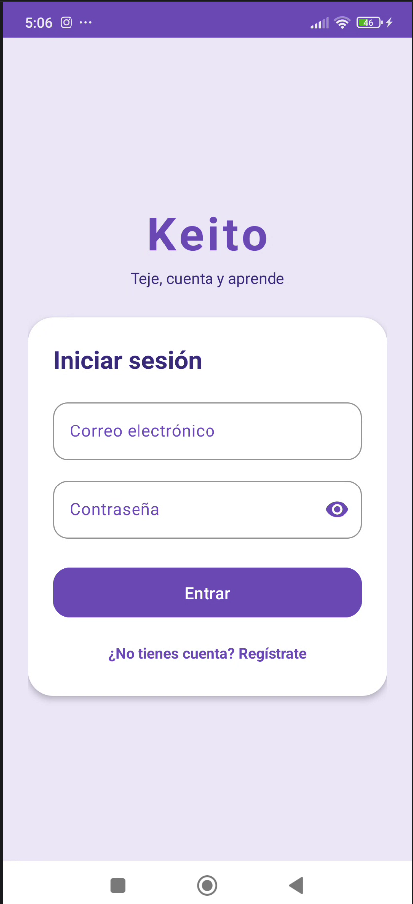 | 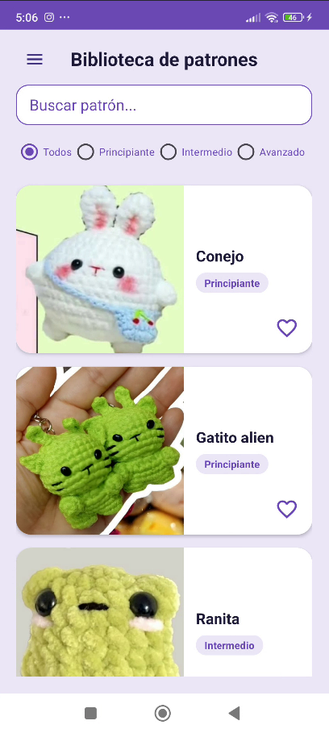 | 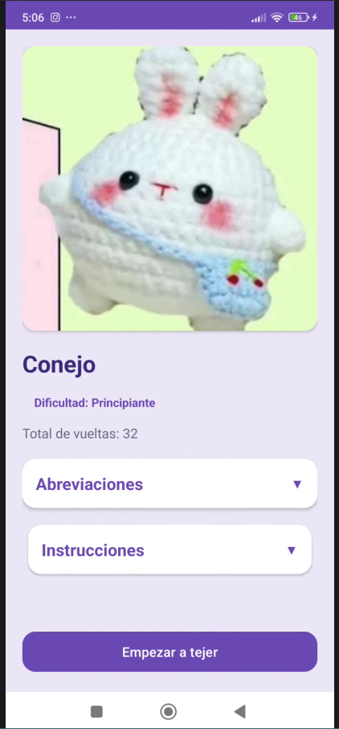 |

| Contador por voz | Favoritos | Mi progreso |
|:---:|:---:|:---:|
| 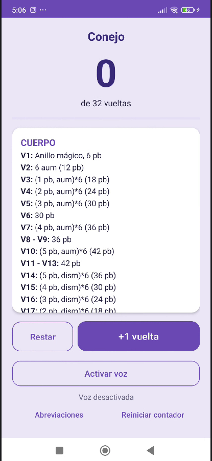 | 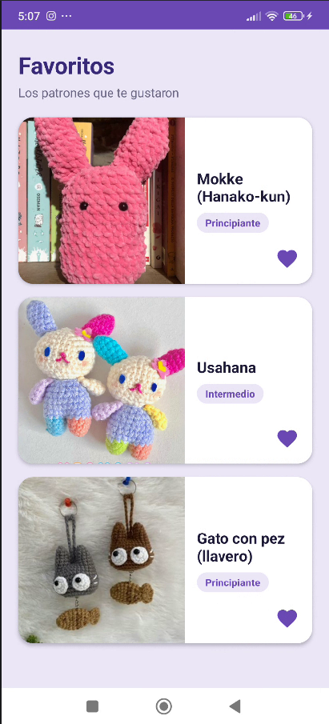 | 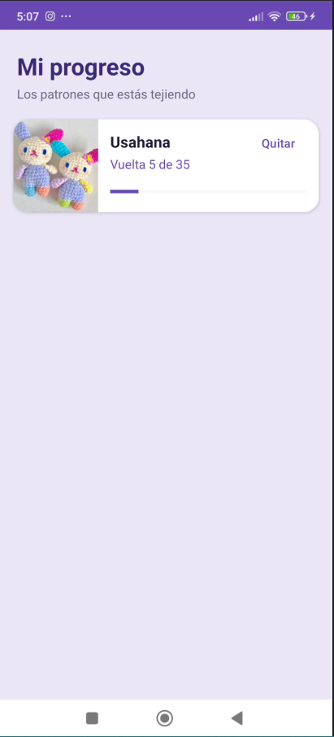 |

| Tutoriales | Tiendas | Menú lateral |
|:---:|:---:|:---:|
| 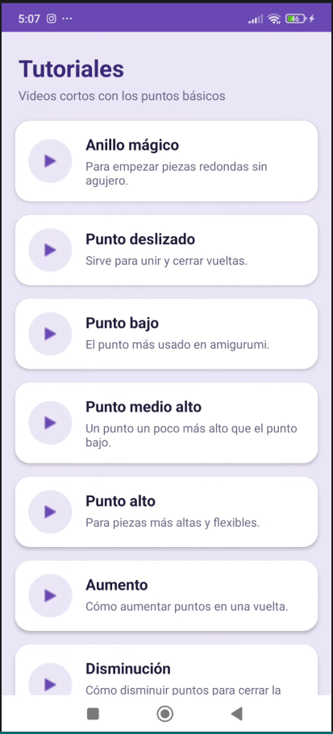 | 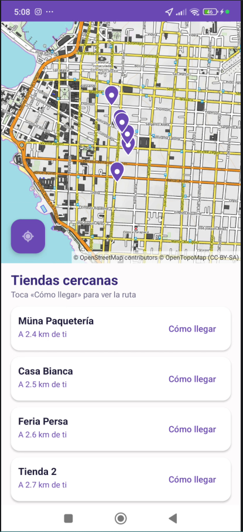 | 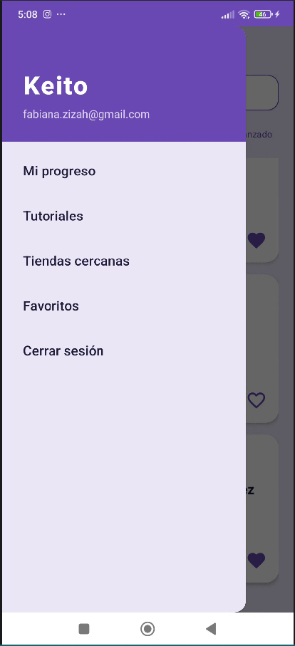 |

## Diagramas

**Diagrama de flujo de actividades (UI Flow / Intents)**

Muestra cómo se pasa de una Activity a otra, qué acción del usuario lo provoca, el tipo de Intent (explícito o implícito), los *Extras* que viajan y los *flags* que controlan el Back Stack.

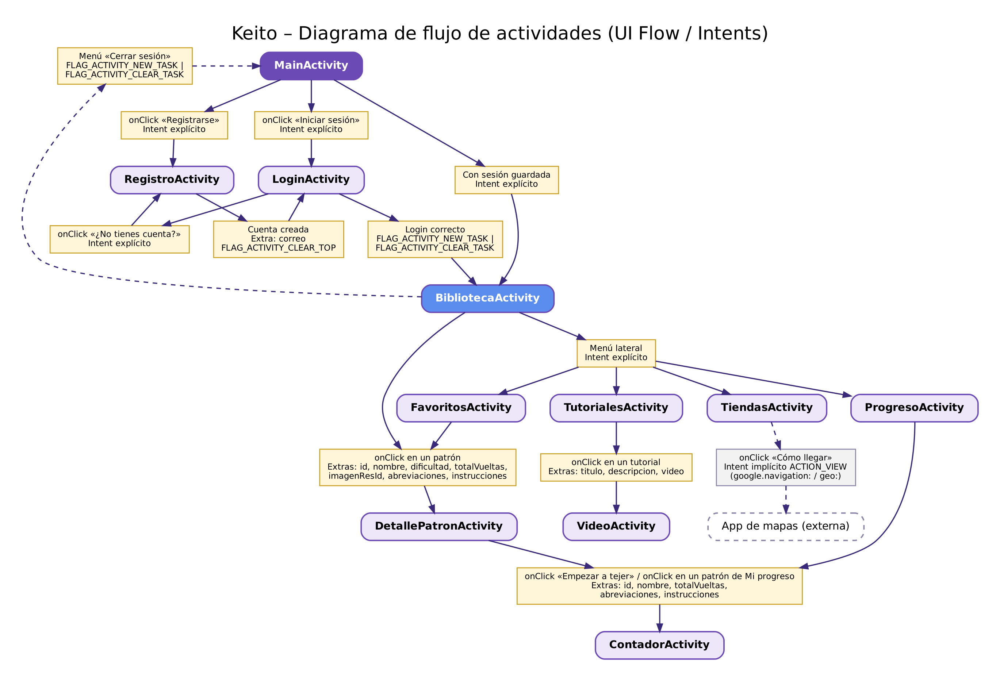

**Modelo Entidad-Relación (MER)**

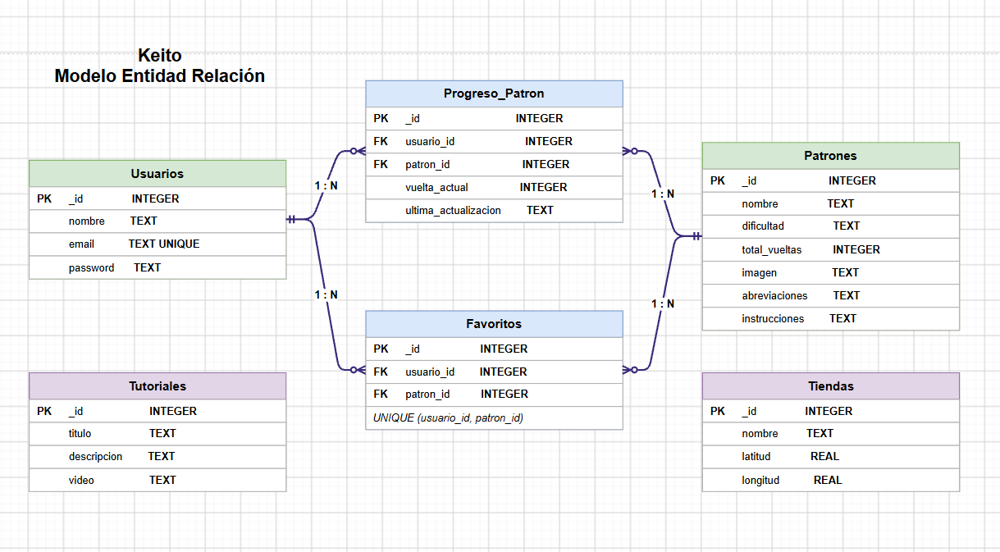

## Tecnologías

| Área | Detalle |
|---|---|
| Lenguaje | Java |
| IDE / Build | Android Studio, Gradle (Groovy DSL) |
| SDK | minSdk 29 (Android 10) · compileSdk 37 · targetSdk 37 |
| Interfaz | Vistas XML, ConstraintLayout, Material Design 3, RecyclerView, CardView, DrawerLayout |
| Base de datos | SQLite con `SQLiteOpenHelper` y clase `Contract` (`BaseColumns`) |
| Hilos | `ExecutorService` para las consultas a la base de datos y `runOnUiThread` para actualizar la pantalla |
| Mapa | [osmdroid](https://github.com/osmdroid/osmdroid) 6.1.20 con mapa base de OpenTopoMap (datos de OpenStreetMap) |
| Ubicación (GPS) | `FusedLocationProviderClient` (Google Play Services Location) con permiso en tiempo de ejecución |
| Voz | `SpeechRecognizer` de Android |
| Video | `VideoView` con `MediaController`, archivos locales en `res/raw` |
| Contraseñas | PBKDF2 con SHA-256 y sal aleatoria (`javax.crypto`) |
| Navegación | Intents explícitos con `putExtra`, Intent implícito (Cómo llegar) y manejo de la pila de actividades (Back Stack) |

## Estructura del proyecto

```
app/src/main/java/com/example/tejido_keito/
├── activities/   Pantallas (Main, Login, Registro, Biblioteca, Detalle, Contador, Progreso, Favoritos, Tutoriales, Video, Tiendas)
├── adapters/     Adaptadores de los RecyclerView
├── database/     KeitoContract y KeitoDbHelper (SQLite)
├── models/       Patron, Tutorial, Tienda
└── utils/        SessionManager (sesión del usuario), PasswordHasher (hash de contraseñas)
docs/             Diagramas y capturas de pantalla
```

## Base de datos

Base SQLite local (`KeitoDbHelper`, versión 2) con seis tablas. Los nombres de tablas y columnas están en `KeitoContract` (`public final`, constructor privado y una clase interna por tabla que implementa `BaseColumns`).

| Tabla | Contenido |
|---|---|
| `usuarios` | Cuentas registradas |
| `patrones` | Patrones precargados |
| `progreso_patron` | Vuelta actual de cada usuario en cada patrón |
| `tutoriales` | Videos tutoriales precargados |
| `tiendas` | Tiendas de lanas precargadas con sus coordenadas |
| `favoritos` | Patrones favoritos de cada usuario |

El CRUD completo se aplica sobre `usuarios` (crear y consultar), `progreso_patron` (crear, leer, actualizar y eliminar) y `favoritos` (agregar, quitar y consultar).

## Seguridad

- Consultas con `selectionArgs` y `ContentValues`, sin concatenar datos del usuario en el SQL.
- Las contraseñas se guardan como hash PBKDF2 con sal, no en texto plano.
- `android:exported="false"` en todas las Activities, menos `MainActivity` (la pantalla de inicio).
- `FLAG_SECURE` en Login y Registro para bloquear las capturas de pantalla.
- `allowBackup="false"` para que no se restaure una base de datos antigua.
- Los permisos de micrófono y ubicación se piden solo cuando se necesitan.

## Documentación del código

Las clases y métodos principales tienen comentarios JavaDoc (`@param`, `@return`, `@throws`): `KeitoDbHelper`, `KeitoContract`, las Activities, los adaptadores, los modelos, `SessionManager` y `PasswordHasher`.

## Cómo ejecutar el proyecto

1. Clonar el repositorio:
```
   git clone [URL-DEL-REPOSITORIO]
```
2. Abrir la carpeta con **Android Studio** y esperar a que termine la sincronización de Gradle.
3. Conectar un teléfono con depuración USB o iniciar un emulador con **Android 10 (API 29) o superior**.
4. Presionar **Run ▶**.

### Requisitos para probar todas las funciones

- **Internet**: para que se carguen las imágenes del mapa.
- **Permiso de ubicación**: para calcular la distancia a las tiendas.
- **Permiso de micrófono**: para el contador de vueltas por voz.
- **GPS activado**: para mostrar tu posición en el mapa.

Si la base de datos cambia entre versiones, desinstala la app o usa *Borrar datos* para que se vuelva a crear. Las cuentas creadas antes de guardar las contraseñas con hash hay que registrarlas de nuevo.

## Flujo de trabajo con Git

- Ramas: `desarrollo` (trabajo), `main` (versión estable) y `entrega-final`.
- Commits semánticos (`feat:`, `fix:`, `docs:`, `refactor:`), por ejemplo `feat: agregar mapa de tiendas con OpenStreetMap, ubicacion y como llegar`.

## Créditos y atribuciones

- Mapa: © [OpenStreetMap contributors](https://www.openstreetmap.org/copyright) y © [OpenTopoMap](https://opentopomap.org) (CC-BY-SA).
- Librería de mapas: [osmdroid](https://github.com/osmdroid/osmdroid) (Apache 2.0).
- Videos tutoriales: Recopilados desde Youtube.
- Imágenes de patrones: recopiladas desde Pinterest.

## Autora

Fabiana Ziza Puebla Corvalán — Ingeniería en Informática, IP-CFT Santo Tomás, sede Iquique.
